---
tags:
  - Junior
  - Middle
  - Senior
  - System Design
  - Микросервисы
  - Кэширование
  - Транзакции
  - Безопасность
---

# Системный дизайн (System Design)

Как спроектировать систему, которая выдержит нагрузку и переживёт сбои: балансировка, кэш, масштабирование БД, очереди, распределённые транзакции и паттерны надёжности. На собесе спрашивают и отдельные блоки — L4 против L7, CAP, шардирование, Saga, circuit breaker, — и целую задачу вроде URL shortener по методологии из шести шагов.

## Сетевой фундамент { #network-basics }

Сетевые протоколы разобраны в [Сети и протоколы](../networks/networks.md): [TCP и UDP](../networks/networks.md#tcp-vs-udp), [эволюция HTTP от 1.1 до 3](../networks/networks.md#http-versions), [DNS](../networks/networks.md#dns-resolution), [что происходит при вводе URL](../networks/networks.md#url-flow) и [выбор между REST, gRPC и GraphQL](../networks/networks.md#rest-vs-grpc). Для дизайна из них важно три вывода: каждый сетевой шаг добавляет задержку, DNS кэшируется и годится только для грубой балансировки, а stateless HTTP позволяет масштабироваться горизонтально.

## Требования и оценки { #fundamentals }

### Синхронно или асинхронно? { #sync-async }

**Уровень:** Junior

!!! abstract "Ответ вслух"
    Синхронный вызов блокирует тебя до ответа: просто, но если получатель тормозит или упал, тормозишь или падаешь и ты. Асинхронный — кладёшь сообщение в очередь и работаешь дальше: сервисы развязаны, пики буферизуются. Цена асинхронности — eventual consistency и сложнее отследить результат.

- **Sync** — вызвал и блокируешься до ответа, как в обычном REST-вызове. Просто, но связность высокая: получатель тормозит или упал — тормозишь или падаешь и ты.
- **Async** — кинул сообщение в очередь (Kafka, RabbitMQ) и работаешь дальше. Это развязка сервисов, буферизация пиков и устойчивость к падениям получателя.

Пример: регистрация пользователя — синхронно, потому что нужен мгновенный ответ. Отправка welcome-письма — в очередь.

!!! warning "Ловушка: всё асинхронно"
    Асинхронность покупается eventual consistency: результат появится позже, и отследить его сложнее. Если пользователю нужен ответ здесь и сейчас — успешна ли регистрация, прошёл ли платёж, — этот шаг оставляют синхронным.

??? question "Проверь себя"
    1. Чем синхронный вызов опасен для вызывающего сервиса?
    2. Что даёт асинхронное общение через очередь?
    3. Какую часть регистрации пользователя делать синхронно, а какую — асинхронно?

### Какими метриками описывают систему? { #metrics }

**Уровень:** Junior

!!! abstract "Ответ вслух"
    Latency — время одного запроса, его меряют перцентилями p50, p95, p99, а не средним. Throughput — сколько запросов система обрабатывает в единицу времени (QPS, RPS). Availability — доля времени, когда система работает: 99.9% — это около 8,8 часа простоя в год.

- **Latency** — время **одного** запроса. Смотрим **перцентили** (p50/p95/p99), а не среднее: p99 = 200 мс значит «1% запросов медленнее 200 мс». Именно хвост портит UX.
- **Throughput** — запросов в **единицу времени** (QPS/RPS). Latency — про один запрос, throughput — про поток.
- **Availability** — доля времени, когда система работает:

| Девятки | Downtime в год |
|---|---|
| 99% | ~3.65 дня |
| 99.9% | ~8.76 часа |
| 99.99% | ~52 минуты |
| 99.999% | ~5 минут |

Каждая следующая девятка — на порядок дороже. Полезно спросить у интервьюера, какая нужна.

- **Consistency** — все ли клиенты видят одни и те же данные. Подробно — в [CAP-теореме](#cap).
- **Durability** — данные не теряются после подтверждённой записи; достигается репликацией на несколько узлов.

!!! warning "Ловушка: среднее вместо перцентилей"
    Средняя latency 50 мс может скрывать 1% запросов по 2 секунды — и эти пользователи уходят. Поэтому смотрят p99. Вторая ловушка — путать durability и availability: данные могут быть целы, но временно недоступны.

??? question "Проверь себя"
    1. Что означает p99 = 200 мс?
    2. Сколько простоя в год допускает 99.99%?
    3. Чем durability отличается от availability?

### Как оценить нагрузку «на салфетке»? { #estimation }

**Уровень:** Middle

!!! abstract "Ответ вслух"
    Считаешь средний QPS из числа активных пользователей, умножаешь на 2–3 для пика, оцениваешь соотношение чтения и записи и объём хранилища на годы. Нужна не точность, а порядок величины. Из чисел делаешь архитектурный вывод: «100:1 — нужен кэш», «терабайты — нужно шардирование».

Оценка «на салфетке» (back-of-the-envelope estimation) обосновывает архитектуру числами, а не «на глаз».

**Числа, которые надо помнить:**

- Секунд в сутках ≈ 86 400 (**~10⁵**), в году ≈ **3×10⁷**.
- ASCII-символ ≈ 1 байт, UUID ≈ 16 байт, JSON-событие ≈ 1 KB, картинка ≈ 100 KB – 1 MB.
- Задержки: RAM — наносекунды, SSD — микросекунды, сеть внутри ДЦ — ~0.5 мс, через океан — ~150 мс.

**Алгоритм на примере** — Twitter-подобный сервис, 300M MAU:

1. **QPS**: DAU ≈ 150M, по 2 запроса в день → 300M / 10⁵ ≈ **3000 QPS** в среднем.
2. **Пик**: трафик неравномерен, ×2–3 → **~9000 QPS**. Мощности проектируем на пик.
3. **Read/Write**: соцсеть ≈ 100:1 → ~30 QPS записи и ~3000 чтения → **кэш обязателен**.
4. **Хранилище**: 30 твитов/с × 300 байт × 3×10⁷ с ≈ **~270 GB/год** текста. С медиа и репликацией ×3 — терабайты → **шардирование**.

!!! warning "Ловушка: считать точно и молча"
    Оценивают ход рассуждения, а не цифру. Округляй агрессивно, считай вслух и обязательно делай вывод: «100:1 → кэш», «терабайты → шардинг», «99.99% → репликация». Число без вывода ничего не даёт.

??? question "Проверь себя"
    1. Сколько секунд в сутках и в году — в порядках величины?
    2. Почему мощности проектируют на пиковый, а не средний QPS?
    3. Какой архитектурный вывод следует из соотношения чтения и записи 100:1?

## Строительные блоки { #building-blocks }

### Чем L4-балансировщик отличается от L7? { #l4-l7 }

**Уровень:** Middle

!!! abstract "Ответ вслух"
    Балансировщик стоит перед серверами, распределяет трафик и убирает мёртвые узлы по health-check'ам. L4 видит только IP и порт и просто перекидывает пакеты — быстро и дёшево. L7 видит URL, заголовки и cookie, поэтому умеет роутить по содержимому и терминировать SSL, но тратит больше ресурсов.

Балансировщик нагрузки (load balancer) — регулировщик на перекрёстке. Он распределяет трафик так, чтобы ни один сервер не упал от перегрузки, пока другие простаивают. Это основа горизонтального масштабирования и высокой доступности.

| | **L4 (Transport — TCP/UDP)** | **L7 (Application — HTTP/HTTPS)** |
|---|---|---|
| **Что видит** | Только IP и порт | URL, заголовки, cookie, тело |
| **Скорость** | Очень быстрый | Медленнее (распаковка пакета) |
| **Ресурсы** | Минимум CPU и памяти | Больше CPU и памяти |
| **Возможности** | Просто перекидывает пакеты | Роутинг по URL, SSL termination, кэш |
| **Пример решения** | «Отправь на сервер 2» | «/images → файловый сервер, /api → бэкенд» |

L4 — простой, но быстрый. L7 — умнее, но дороже: терминирует SSL, то есть расшифровывает HTTPS на балансировщике, и роутит по содержимому. Номера L4 и L7 — уровни модели OSI, см. [Сети → OSI и TCP/IP](../networks/networks.md#osi-tcpip).

Стандартный первый ход в дизайне: «Ставим L7-балансировщик с health-check'ами перед пулом **stateless**-серверов, сессии — в Redis».

!!! warning "Ловушка: роутинг по URL на L4"
    L4-балансировщик не расшифровывает трафик и не видит HTTP, поэтому «/api на бэкенд, /images на файловый сервер» он сделать не может. Для роутинга по содержимому и SSL termination нужен L7.

??? question "Проверь себя"
    1. Что видит L4-балансировщик, а что — L7?
    2. Что такое SSL termination и на каком балансировщике она возможна?
    3. С чего начинается типичный дизайн с балансировщиком?

### Какие есть алгоритмы балансировки? { #lb-algorithms }

**Уровень:** Middle

!!! abstract "Ответ вслух"
    Round Robin раздаёт запросы по очереди и подходит, когда серверы и запросы одинаковы; Weighted Round Robin даёт мощному серверу больший вес. Least Connections шлёт трафик туда, где меньше активных подключений, — это нужно для тяжёлых долгих запросов. IP hash и consistent hashing всегда отправляют клиента на один и тот же сервер.

- **Round Robin (карусель)** — запросы раздаются по очереди: серверу 1, 2, 3, снова 1. Подходит, когда серверы одинаковы и запросы примерно равны по нагрузке. **Weighted Round Robin** даёт мощному серверу больший вес.
- **Least Connections** — трафик идёт на сервер с наименьшим числом активных подключений. Нужен для тяжёлых долгих запросов — скачивания файлов, WebSocket, сложных отчётов, — где Round Robin может добить уже занятый сервер.
- **IP hash / Consistent hashing** — один клиент всегда попадает на один сервер без sticky-куки. Про consistent hashing — [ниже](#consistent-hashing).

!!! warning "Ловушка: Round Robin и неравные запросы"
    Round Robin не знает веса запроса и продолжает слать новые на сервер, который уже занят тяжёлыми. Результат — один сервер падает от OOM, остальные простаивают. Разбор такого случая — в [кейсе с PDF-отчётами](#case-round-robin).

??? question "Проверь себя"
    1. Когда Round Robin работает хорошо?
    2. Для каких запросов нужен Least Connections?
    3. Как добиться, чтобы клиент всегда попадал на один сервер без cookie?

### Почему sticky sessions — антипаттерн? { #sticky-sessions }

**Уровень:** Junior

!!! abstract "Ответ вслух"
    Sticky sessions привязывают клиента к одному серверу через cookie, чтобы не потерять сессию в памяти сервера. Но нагрузка распределяется неравномерно, а при падении сервера все привязанные к нему пользователи теряют сессии. Правильно — хранить сессии вне сервера, например в Redis.

Пользователь залогинился, сессия в памяти Сервера А. Следующий запрос балансировщик кинул на Сервер Б — пользователь «разлогинился». Sticky sessions (липкие сессии) привязывают клиента к одному серверу через cookie.

!!! warning "Ловушка: лечить привязкой, а не хранением"
    Липкие сессии ломают равномерность — на одном сервере скапливается много пользователей. А если сервер падает, все «прилипшие» к нему теряют сессии. Правильное решение — хранить сессии не в памяти, а в Redis: тогда любой сервер обслужит любого пользователя.

??? question "Проверь себя"
    1. Какую проблему пытаются решить sticky sessions?
    2. Назови два недостатка sticky sessions.
    3. Где хранить сессии, чтобы любой сервер мог обслужить любого пользователя?

### Где и как кэшировать? { #caching }

**Уровень:** Middle

!!! abstract "Ответ вслух"
    Кэш снижает latency и разгружает БД; при соотношении чтения и записи 100:1 он решает почти всё. Уровни — браузер, CDN, кэш приложения (Redis, Memcached) и БД как источник истины. Основные паттерны записи — Cache-Aside, Write-Through и Write-Behind.

**Уровни кэша** — hit на любом из них, и дальше запрос не идёт:

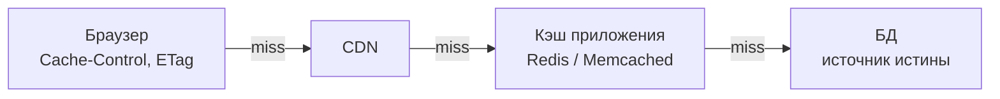

До БД доходят только промахи.

**Паттерны кэширования:**

- **Cache-Aside (Lazy Loading)** — приложение сначала идёт в кэш. Hit — отдаём; miss — идём в БД, кладём результат в кэш и отдаём. Кэшируется только то, что реально запрашивают, и если кэш упадёт, система выживет, обращаясь к БД напрямую.
- **Write-Through (сквозная запись)** — пишем в кэш, кэш синхронно пишет в БД, ответ приходит, когда сохранилось в обоих местах. В кэше всегда свежие данные, но запись медленнее.
- **Write-Behind (отложенная запись)** — пишем в кэш и сразу получаем ОК, а кэш асинхронно сбрасывает данные в БД пачками. Запись максимально быстрая — подходит для счётчиков просмотров и лайков.

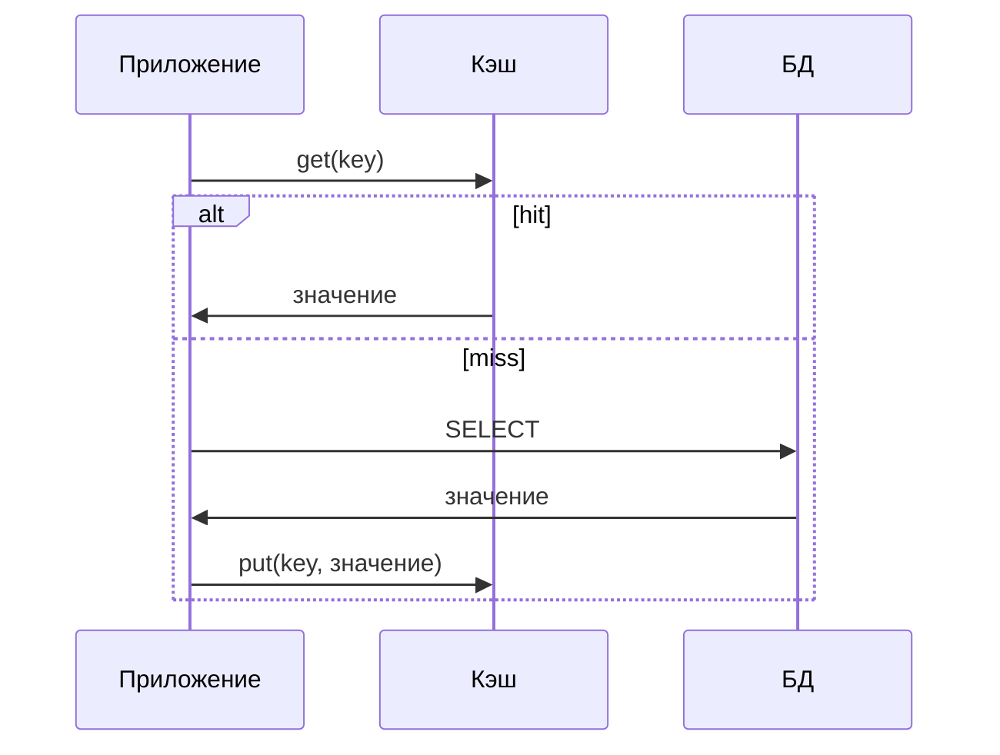

Cache-Aside в Spring делается аннотацией `@Cacheable` — настройка и подводные камни разобраны в [Spring: Инструменты](../spring/spring-tools.md). Тот же паттерн на Redis — в [NoSQL](../database/nosql.md).

!!! warning "Ловушка: Write-Behind для важных данных"
    Если кэш сгорит до сброса в БД, данные потеряны. Write-Behind годится для того, что не жалко потерять, — счётчиков, лайков, просмотров. Деньги и заказы так не пишут.

??? question "Проверь себя"
    1. Как работает Cache-Aside при hit и при miss?
    2. Чем Write-Through отличается от Write-Behind?
    3. Что случится с системой на Cache-Aside, если кэш упадёт?

### Как кэш вытесняет и инвалидирует данные? { #eviction }

**Уровень:** Junior

!!! abstract "Ответ вслух"
    Когда кэш заполнен, LRU выкидывает то, к чему дольше всего не обращались, LFU — то, к чему обращались меньше всего раз. TTL удаляет записи по истечении времени жизни и обычно комбинируется с LRU. Чтобы не отдавать устаревшее, ставят короткий TTL или явно удаляют ключ при записи в БД.

**Стратегии вытеснения (eviction):**

- **LRU (Least Recently Used)** — выкидывает то, к чему дольше всего не обращались. Стандартный выбор: вчерашняя статья уйдёт и освободит место сегодняшней популярной.
- **LFU (Least Frequently Used)** — выкидывает то, к чему обращались меньше всего раз. Хорошо для статических справочников, плохо для трендов.
- **TTL** — запись удаляется по истечении времени жизни; обычно комбинируется с LRU.

**Инвалидация** — как не отдавать устаревшее после изменения в БД: короткий TTL либо явное удаление или обновление ключа при записи. Недаром шутка: «в программировании две сложные вещи — инвалидация кэша и придумывание имён».

!!! warning "Ловушка: LFU для трендов"
    LFU копит счётчики: статья, которую читали миллион раз месяц назад, вытеснит сегодняшнюю, у которой пока тысяча просмотров. Там, где популярность быстро меняется, берут LRU.

??? question "Проверь себя"
    1. Чем LRU отличается от LFU?
    2. Почему LFU плохо подходит для новостной ленты?
    3. Какими двумя способами инвалидируют кэш?

### Что такое cache stampede и как его лечить? { #cache-stampede }

**Уровень:** Senior

!!! abstract "Ответ вслух"
    Cache stampede, или thundering herd, — когда популярный ключ протухает и тысячи запросов одновременно получают miss и бьют в БД. База ложится от перегрузки. Лечат мьютексом — в БД идёт только первый поток, остальные ждут или получают устаревшую копию, — либо вероятностным ранним обновлением до истечения TTL.

Главная страница закэширована с TTL = 5 минут:

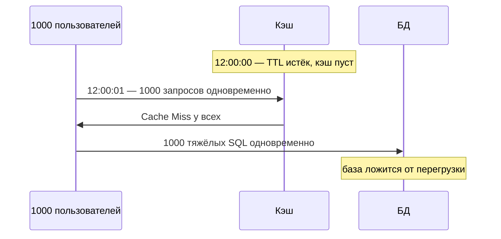

Как лечить:

- **Mutex / Lock** — когда кэш протухает, право сходить в БД получает только первый поток, захвативший лок. Остальные 999 ждут или получают чуть устаревшую копию (stale data), пока первый не обновит кэш. Приём знаком по [блокировкам в Java](../concurrency/locks.md).
- **Probabilistic early expiration** — вероятностное раннее обновление до истечения TTL, чтобы ключ не протухал у всех одновременно.

!!! warning "Ловушка: одинаковый TTL у всех ключей"
    Если кэш прогрели разом с одним TTL, все ключи протухнут одновременно — и stampede случится не на одном ключе, а на всём кэше. Именно так в [кейсе с падением базы в 10:10](#case-stampede) кэш, созданный в 10:00 с TTL 10 минут, истёк ровно в 10:10.

??? question "Проверь себя"
    1. Почему истечение одного популярного ключа может положить БД?
    2. Как мьютекс защищает от cache stampede?
    3. Что такое probabilistic early expiration?

### Redis, Memcached или Hazelcast? { #redis-hazelcast }

**Уровень:** Senior

!!! abstract "Ответ вслух"
    Memcached — простой key-value кэш в памяти, Redis — богаче: структуры данных, персистентность, pub/sub; сегодня это выбор по умолчанию. Redis Cluster делит ключи на 16 384 хэш-слота, а клиент сам знает, на каком узле слот. Hazelcast — In-Memory Data Grid на Java: 271 партиция и выполнение кода прямо на узле с данными.

Memcached — простой key-value кэш в памяти. Redis богаче: структуры данных (списки, sorted sets), персистентность, pub/sub — дефолтный выбор сегодня. Дальше — нюансы кластеризации:

| | **Redis** | **Hazelcast** |
|---|---|---|
| **Что это** | In-Memory Data Structure Store (C) | In-Memory Data Grid (Java) |
| **Шардирование** | 16 384 хэш-слота по Master-узлам | 271 партиция, у каждого узла основные + backup |
| **Маршрутизация** | Smart Clients (Lettuce/Jedis знают карту) | P2P, узлы равны |
| **Сильная сторона** | Скорость, простота | Data Locality — EntryProcessor выполняется на узле с данными |
| **Консистентность** | AP по умолчанию | AP + CP Subsystem (Raft) для надёжных локов |

**Redis Cluster.** Центрального узла нет, узлы общаются по Gossip-протоколу. Клиент сам знает, что `user:123` лежит на Узле 2, через хэш-слот; если карта устарела, узел ответит `MOVED`, и клиент её обновит. У каждого Master есть Replica: при падении узлы голосуют и повышают реплику до Master.

**Hazelcast Data Locality.** Чтобы обновить зарплату миллиону сотрудников, в Redis пришлось бы тащить миллион записей по сети. В Hazelcast отправляешь маленький `EntryProcessor` — кусок Java-кода — внутрь кластера, и он выполняется прямо на узлах с данными. Сеть не нагружается.

!!! warning "Ловушка: failover Redis без потерь"
    Репликация в Redis Cluster асинхронная. Если Master принял запись и сгорел до репликации, после повышения реплики этих данных не будет. Для кэша это не критично — он пересоберётся из БД, — но хранить в Redis единственную копию важных данных так нельзя.

??? question "Проверь себя"
    1. Что делает клиент Redis Cluster, получив ответ `MOVED`?
    2. Что такое data locality в Hazelcast и зачем нужен `EntryProcessor`?
    3. Почему при failover Redis можно потерять последние записи?

### SQL или NoSQL? { #sql-vs-nosql }

**Уровень:** Junior

!!! abstract "Ответ вслух"
    SQL — строгая схема, связи через внешние ключи, JOIN'ы и ACID-транзакции; это выбор по умолчанию для структурированных данных, где важна согласованность. NoSQL — зонтик из четырёх семейств: key-value, документные, колоночные и графовые, каждое заточено под свой паттерн доступа. NoSQL берут под конкретную причину, а не «потому что модно».

**SQL** (Postgres, MySQL) — строгая схема, связи через внешние ключи, JOIN'ы, транзакции ACID. Бери, когда данные структурированы и связаны, важна согласованность (деньги, заказы), а объём умеренный.

**NoSQL** — четыре типа, каждый под свой паттерн доступа:

- **Key-value** (Redis, DynamoDB) — «ключ → значение», самый быстрый доступ по ключу. Кэши, сессии, простые lookup'ы.
- **Document** (MongoDB) — JSON-документы, гибкая схема. Каталоги, профили.
- **Column-family** (Cassandra) — гигантские объёмы, write-heavy, линейно масштабируется. Логи, метрики, лента.
- **Graph** (Neo4j) — узлы и связи. Соцграф, рекомендации.

Семейства подробно разобраны в [NoSQL](../database/nosql.md).

**Индексы** — B-дерево: чтение по колонке превращается из полного перебора в быстрый поиск. Расплата — место на диске и замедление записи, ведь каждый INSERT или UPDATE обновляет и индекс. Индексируют то, по чему ищут и сортируют, а не всё подряд; типы индексов и `EXPLAIN` — в [SQL и транзакции](../database/sql.md).

**ACID** — atomicity (всё или ничего), consistency (из валидного состояния в валидное), isolation (параллельные транзакции не мешают друг другу), durability (закоммичено — не потеряется). Аномалии и уровни изоляции разобраны в [SQL и транзакции](../database/sql.md).

!!! warning "Ловушка: NoSQL «потому что модно»"
    Без чётко известного паттерна доступа, под который база заточена, NoSQL даёт боль без выгоды: нет JOIN'ов, нет привычных транзакций. SQL — по умолчанию, NoSQL — под конкретную причину.

??? question "Проверь себя"
    1. Когда выбирать реляционную базу?
    2. Назови четыре семейства NoSQL и задачу для каждого.
    3. Чем платят за индекс?

### Как масштабировать БД репликацией? { #replication }

**Уровень:** Middle

!!! abstract "Ответ вслух"
    Масштабирование БД идёт в три этапа: репликация, партиционирование, шардирование — и сразу шардировать нельзя. При репликации Master принимает запись, а реплики обслуживают чтение. Это разгружает Master и даёт высокую доступность, но реплики отстают — replication lag.

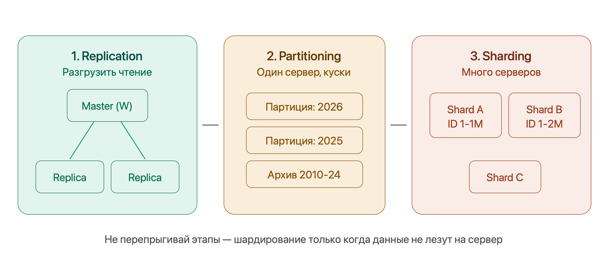

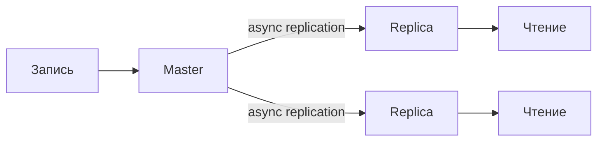

Master принимает запись (INSERT, UPDATE, DELETE), реплики — только чтение (SELECT). Если Master умер, реплика становится новым Master.

- **Master-Master** — писать можно в несколько узлов: запас по записи, гео-распределение. Плата — **конфликты записи**, когда два узла изменили одно и то же по-разному; их разрешают, например, по last-write-wins с timestamp.
- **Синхронная репликация** — master ждёт подтверждения реплик перед ответом: durability, но медленно.
- **Асинхронная репликация** — master отвечает сразу: быстро, но есть lag и риск потерять хвост незареплицированных записей при падении master.

!!! warning "Ловушка: replication lag"
    Копирование с Master на реплику занимает миллисекунды, а под нагрузкой — секунды. Записал данные, тут же прочитал с реплики — а их там ещё нет. Для критичных чтений читают с Master — это модель read-your-writes.

??? question "Проверь себя"
    1. В каком порядке масштабируют БД?
    2. Чем синхронная репликация отличается от асинхронной?
    3. Что такое replication lag и как с ним жить?

### Чем партиционирование отличается от шардирования? { #partitioning }

**Уровень:** Middle

!!! abstract "Ответ вслух"
    Партиционирование делит таблицу на части внутри одного сервера: горизонтально по строкам (например, по месяцам) или вертикально по столбцам. Шардирование размазывает данные по нескольким серверам по ключу шарда. Партиционирование почти бесплатно для приложения, шардирование ломает JOIN'ы и транзакции.

Партиционирование (partitioning) происходит на **одном сервере**, внутри одной БД.

- **Горизонтальное (по строкам)** — гигантская таблица бьётся на партиции по правилу, например по месяцам. Для приложения таблица одна (`news`), но физически январь хранится отдельно от февраля. Ищем за март — БД не трогает январь.
- **Вертикальное (по столбцам)** — тяжёлые колонки (`avatar_image_bytes`, `huge_bio_text`) выносятся в отдельную таблицу `user_details` (1-к-1). В основной остаются частые `id`, `name`, `email`, и строки помещаются в кэш БД.

Шардирование — уже несколько серверов, разбор [ниже](#sharding).

!!! warning "Ловушка: шардировать то, что решается партиционированием"
    Если горячие данные — маленькая свежая часть таблицы, партиционирование по дате решает задачу на одном сервере. Шардирование здесь принесёт всю боль распределённой системы без выгоды — разобрано в [кейсе про 100M строк](#case-sharding).

??? question "Проверь себя"
    1. Где физически живут партиции, а где — шарды?
    2. Чем горизонтальное партиционирование отличается от вертикального?
    3. Как партиционирование по месяцам ускоряет запрос за март?

### Как шардировать и выбрать shard key? { #sharding }

**Уровень:** Senior

!!! abstract "Ответ вслух"
    Шардирование нужно, когда данные не помещаются на один сервер: строки распределяются по узлам на основе ключа шарда (shard key). Range-based ключ удобен для диапазонных запросов, но даёт перекос; hash-based распределяет равномерно, но диапазонные запросы идут во все шарды. Цена шардирования — JOIN'ы, распределённые транзакции и ребалансировка.

Данные размазываются по узлам на основе **shard key**: пользователи с ID 1–1M — на Сервере А, 1M–2M — на Сервере Б.

**Цена шардирования:**

1. **JOIN'ы перестают работать** — нельзя сделать JOIN между таблицами на разных серверах, джоины переезжают в Java-код.
2. **Распределённые транзакции** — перевод денег между серверами не покрыть обычным `BEGIN...COMMIT`, нужен [2PC](#two-phase-commit) или [Saga](#saga).
3. **Ребалансировка** — Сервер А заполнился, добавляем Сервер В и без остановки продакшена переносим на него часть данных.

**Выбор shard key** — ключевое решение, от него зависит равномерность:

- **Range-based** (по диапазону: дата, id, алфавит) — просто, удобны диапазонные запросы. Но легко получить перекос: весь свежий трафик бьёт в один шард.
- **Hash-based** (хэш от ключа) — равномерно. Но диапазонные запросы («все заказы за март») размазаны по всем шардам — дорого.

!!! warning "Ловушка: hotspot"
    Hotspot — шард, который получает непропорционально много трафика. Классика — «звёздный» пользователь: шард знаменитости с миллионами подписчиков перегружен. Лечится подмешиванием суффикса в ключ или выделением таких сущностей отдельно.

??? question "Проверь себя"
    1. Какие три проблемы приносит шардирование?
    2. Чем range-based shard key отличается от hash-based?
    3. Что такое hotspot и как его лечат?

### Что такое consistent hashing? { #consistent-hashing }

**Уровень:** Senior

!!! abstract "Ответ вслух"
    При наивном `hash(key) % N` добавление или удаление сервера меняет N, и почти все ключи переезжают. Consistent hashing замыкает пространство хэшей в кольцо: серверы — точки на нём, ключ обслуживает первый сервер по часовой стрелке. Новый узел забирает только соседний участок, а виртуальные узлы делают распределение равномерным.

Проблема `hash(key) % N`: добавили или убрали сервер — изменился N — **почти все ключи** переехали на новые места. Для кэша это тотальный miss, для шардов — массовая перебалансировка.

Решение — **кольцо**. Диапазон значений хэша замыкаем в круг, серверы ставим точками на нём по хэшу имени, а каждый ключ обслуживает первый сервер по часовой стрелке. Добавление или удаление узла двигает только **соседний участок** ключей — малую долю, а не всё.

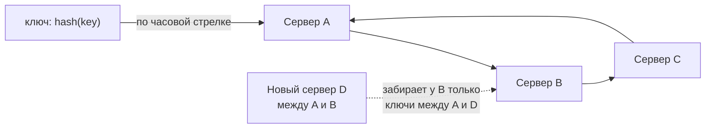

Для равномерности каждый физический сервер представлен множеством **виртуальных узлов** — много точек на кольце.

Где применяется: распределённые кэши, Cassandra, DynamoDB. 16 384 хэш-слота Redis Cluster и 271 партиция Hazelcast — инженерные вариации той же идеи.

!!! warning "Ловушка: кольцо без виртуальных узлов"
    Если у каждого сервера одна точка на кольце, участки получаются разного размера, и один сервер может обслуживать в разы больше ключей. Кроме того, при падении узла весь его участок достаётся одному соседу. Виртуальные узлы размазывают и нагрузку, и последствия падения.

??? question "Проверь себя"
    1. Что не так с `hash(key) % N` при добавлении сервера?
    2. Какой сервер обслуживает ключ на кольце?
    3. Зачем нужны виртуальные узлы?

### Зачем нужны очереди сообщений? { #message-queues }

**Уровень:** Junior

!!! abstract "Ответ вслух"
    Очередь — посредник для асинхронного общения: producer кладёт сообщение, consumer забирает в своём темпе. Она даёт развязку сервисов, буферизацию пиков и устойчивость к падению получателя. Модели две: point-to-point, где сообщение получает один consumer, и pub/sub, где его получают все подписчики.

Что даёт очередь:

- **Развязка** — сервисы не знают друг о друге.
- **Буферизация** — пик оседает в очереди, а не роняет получателя.
- **Устойчивость** — получатель упал, сообщения ждут.

Две модели:

- **Point-to-point (queue)** — сообщение получает **один** consumer из группы. Это распределение задач: обработать платёж, отправить письмо.
- **Pub/Sub (topic)** — сообщение получают **все** подписчики. Это события: «заказ создан» → склад, аналитика, почта.

| | **RabbitMQ** | **Kafka** |
|---|---|---|
| **Суть** | Классический брокер очередей | Распределённый лог событий |
| **Сообщения** | Удаляются после подтверждения | Хранятся, можно перечитать заново |
| **Сильная сторона** | Гибкая маршрутизация, модель «сделай задачу» | Огромный throughput, стриминг событий, event sourcing |

Устройство Kafka разобрано в [Kafka: Физика брокера](../kafka/kafka.md).

!!! warning "Ловушка: poison pill"
    Сломанное сообщение, которое консьюмер не может обработать, брокер будет отдавать снова и снова — и очередь встанет. Поэтому после нескольких ретраев с растущей паузой (например, 1 с, 3 с, 10 с) сообщение перекладывают в Dead Letter Queue, и очередь работает дальше. Как это настраивается, разобрано в [Kafka: Гарантии доставки](../kafka/kafka-reliability.md).

??? question "Проверь себя"
    1. Какие три свойства даёт очередь сообщений?
    2. Чем point-to-point отличается от pub/sub?
    3. Чем Kafka отличается от RabbitMQ в хранении сообщений?

### Что даёт CDN? { #cdn }

**Уровень:** Junior

!!! abstract "Ответ вслух"
    CDN (Content Delivery Network) — сеть географически распределённых edge-серверов, которые кэшируют статику рядом с пользователем. Запрос через океан идёт ~150 мс, до ближайшего edge — единицы миллисекунд. В любой системе с картинками или видео CDN появляется по умолчанию.

CDN кэширует картинки, видео, JS и CSS рядом с пользователем.

- **Pull** — CDN сам тянет контент с origin при первом промахе и кэширует. Это дефолт, просто.
- **Push** — заливаешь контент заранее сам. Больше контроля.
- Бонусы: разгрузка origin-сервера, TLS-терминация на краю, защита от DDoS.

!!! warning "Ловушка: первый запрос в Pull CDN"
    В модели Pull первый запрос к новому контенту — промах: edge идёт за ним на origin, и пользователь получает полную задержку. Если важно, чтобы контент был на краю заранее, например к релизу видео, используют Push.

??? question "Проверь себя"
    1. Почему CDN снижает задержку?
    2. Чем Pull CDN отличается от Push CDN?
    3. Что CDN даёт, кроме скорости?

## Теория распределённых систем { #distributed }

### Что утверждает CAP-теорема? { #cap }

**Уровень:** Middle

!!! abstract "Ответ вслух"
    CAP говорит, что из согласованности (Consistency), доступности (Availability) и устойчивости к разделению сети (Partition tolerance) при сбое можно гарантировать только два. Сеть в реальном мире ломается всегда, поэтому P — не опция, и выбор идёт между C и A в момент аварии. Для платежей берут CP, для корзины и закладок — AP.

- **C (Consistency)** — каждый клиент видит самые последние данные или ошибку. Никто не видит устаревшую версию.
- **A (Availability)** — любой живой узел всегда отвечает без ошибки.
- **P (Partition tolerance)** — система работает, даже если сеть между узлами порвалась.

При обрыве связи между дата-центрами:

- **CP-система** — запрещаем запись и чтение на изолированном узле. Пользователь видит «Ошибка 500» (жертвуем A), но никто не прочитает устаревшую финансовую сводку. _Примеры: MongoDB, HBase, Redis Cluster в строгом режиме, ZooKeeper/etcd._
- **AP-система** — узел продолжает отвечать из того, что у него есть. Сайт работает, но данные могут быть устаревшими (жертвуем C). Это **eventual consistency**: когда сеть починят, узлы синхронизируются. _Примеры: Cassandra, DynamoDB, Hazelcast._

CAP с точки зрения семейств NoSQL разобрана в [NoSQL](../database/nosql.md).

!!! warning "Ловушка: «выбираем CA»"
    CA-системы в распределённом мире не бывает: разделение сети случится, и тогда придётся выбрать, отказать или отдать устаревшее. Правильная формулировка: «поскольку P неизбежно, вопрос — чем жертвуем при разделении».

??? question "Проверь себя"
    1. Почему P в CAP — не опция?
    2. Как ведёт себя CP-система при разделении сети, а как — AP?
    3. Что выбрать для сервиса закладок и что — для платежей?

### Что добавляет PACELC? { #pacelc }

**Уровень:** Senior

!!! abstract "Ответ вслух"
    CAP описывает только момент аварии, а 99.9% времени сеть работает. PACELC добавляет вторую половину: если разделение (P) — выбираем между A и C, иначе (E, else) — между задержкой (L, latency) и согласованностью (C). Быстрый ответ без ожидания реплик — это L, ожидание подтверждения от всех узлов — это C.

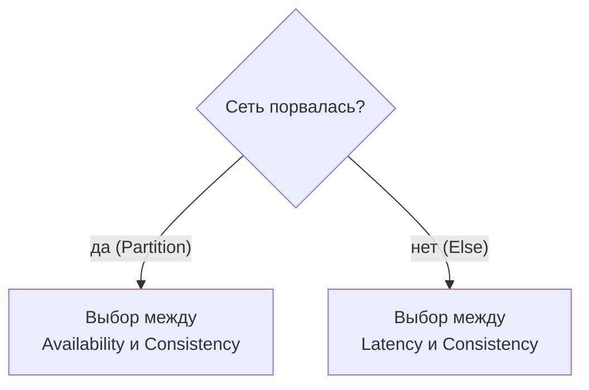

Сеть в порядке, пользователь публикует срочный пресс-релиз:

- **Выбрал Latency** — узел записал к себе и сразу ответил ОК. Быстро, но пока данные асинхронно летят на другие узлы, кто-то прочитает старую версию.
- **Выбрал Consistency** — узел записал, дождался записи на всех узлах и только потом ответил ОК. Согласованность полная, но задержка большая.

!!! warning "Ловушка: обсуждать только аварию"
    Если на вопрос о согласованности отвечать только через CAP, упускаешь основной режим работы системы. Большую часть времени выбор стоит между latency и consistency — его и надо проговорить для каждой операции.

??? question "Проверь себя"
    1. Что означают буквы в PACELC?
    2. Какой выбор приходится делать, когда сеть работает?
    3. Что выберет сервис закладок при рабочей сети?

### Какие бывают модели согласованности? { #consistency-models }

**Уровень:** Senior

!!! abstract "Ответ вслух"
    От строгих к слабым: strong (линеаризуемость), causal, read-your-writes, monotonic reads и eventual. Чем строже модель, тем больше координации и тем медленнее система. Задача дизайна — выбрать минимально достаточную модель под каждую операцию, а не тащить strong везде.

Спектр гарантий — от строгих (медленно, нужна координация) к слабым (быстро):

- **Strong (линеаризуемость)** — любое чтение видит последнюю запись, как будто копия одна. Деньги, остатки товара на складе.
- **Causal** — причинно-связанные события все видят в правильном порядке: ответ на комментарий не появится раньше самого комментария. Независимые события могут расходиться.
- **Read-your-writes** — **свои** изменения видишь всегда, даже если чужие ещё догоняют. Лечит «написал коммент → обновил страницу → его нет» при replication lag.
- **Monotonic reads** — данные не «прыгают назад во времени»: раз увидел значение, более старое уже не покажут.
- **Eventual** — реплики расходятся ненадолго, но сойдутся. Лайки, лента, счётчики просмотров.

!!! warning "Ловушка: strong consistency везде"
    Строгая согласованность требует координации узлов на каждую операцию и стоит latency и availability. Для лайков и счётчиков просмотров хватает eventual, а read-your-writes закрывает самую заметную пользователю проблему — пропавший собственный комментарий.

??? question "Проверь себя"
    1. Чем causal consistency отличается от strong?
    2. Какую проблему решает read-your-writes?
    3. Какая модель достаточна для счётчика лайков?

### Как узлы договариваются: Raft и Paxos? { #consensus }

**Уровень:** Senior

!!! abstract "Ответ вслух"
    Консенсус — способ узлам договориться об одном значении или порядке операций, несмотря на сбои. В Raft узлы выбирают лидера, лидер упорядочивает и реплицирует записи, и запись принята, когда её подтвердило большинство — кворум N/2+1. Поэтому кластеры делают нечётного размера: 3 или 5 узлов.

**Paxos** — классический алгоритм, известный тем, что его трудно понять; **Raft** сделан понятным. Интуиция Raft:

1. Узлы выбирают **лидера** (leader election).
2. Лидер принимает все записи, упорядочивает и реплицирует.
3. Запись принята, когда её подтвердило **большинство** — кворум, N/2+1.

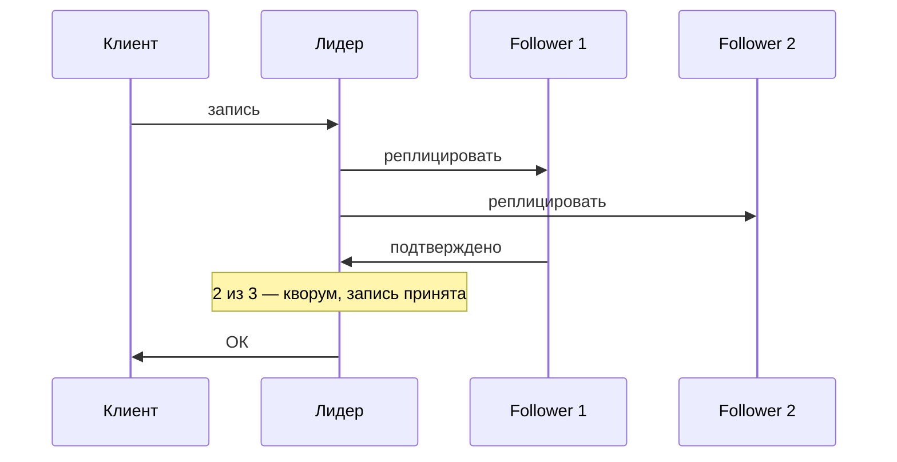

Следствия:

- Кластеры делают **нечётного размера** (3, 5) — большинство определяется однозначно.
- Кластер переживает падение меньшинства узлов, но встаёт без большинства.
- Два конфликтующих решения не могут победить одновременно — любые два большинства пересекаются.

Raft используют etcd, Consul, Kafka KRaft, CP Subsystem в Hazelcast; он же выбирает новый Master при failover. **ZooKeeper** использует не Raft, а собственный протокол **ZAB** (ZooKeeper Atomic Broadcast) с той же идеей: лидер, кворум, упорядоченная репликация. Реализовывать это самому не надо — надо понимать, что внутри этих систем и зачем.

!!! warning "Ловушка: кластер из 4 узлов"
    Кворум для 4 узлов — 3, поэтому кластер переживает падение только одного узла, ровно как кластер из 3. Четвёртый узел добавляет стоимость, но не отказоустойчивость. Поэтому размер кластера — нечётный.

??? question "Проверь себя"
    1. Из каких трёх шагов состоит интуиция Raft?
    2. Почему кластеры консенсуса делают нечётного размера?
    3. Какой протокол консенсуса использует ZooKeeper?

### Какие бывают гарантии доставки и при чём тут идемпотентность? { #delivery-guarantees }

**Уровень:** Middle

!!! abstract "Ответ вслух"
    At-most-once — доставим максимум раз, можно потерять; at-least-once — ретраим до подтверждения, возможны дубликаты; exactly-once — ровно один раз, но end-to-end дорого. Брокеры по умолчанию дают at-least-once. Поэтому exactly-once на практике — это at-least-once доставка плюс идемпотентная обработка.

- **At-most-once** — доставим максимум раз, без ретраев. Можно терять. Некритичные метрики.
- **At-least-once** — ретраим до подтверждения, поэтому возможны **дубликаты**. Дефолт брокеров (Kafka, RabbitMQ).
- **Exactly-once** — ровно один раз. End-to-end дорог и труднодостижим.

**Exactly-once на практике = at-least-once доставка + идемпотентная обработка.** Смиряемся с дубликатами на доставке, но делаем обработку безопасной к повтору.

**Идемпотентность** — повторное выполнение равно однократному по эффекту: `GET` и `set(x=5)` идемпотентны, `increment(x)` — нет. Приём для API — **idempotency key**: клиент шлёт уникальный id запроса, сервер запоминает обработанные и на повтор возвращает прежний результат, не выполняя операцию заново. Так работают платёжные API, например Stripe: при ретрае деньги не спишутся дважды.

**Idempotent consumer** — консьюмер, у которого повторная обработка не создаёт дублей побочных эффектов: пользователь не получит три одинаковых письма. Два способа — проверка по `event_id` перед обработкой и UNIQUE constraint в БД, который надёжнее; код для `@KafkaListener` разобран в [Kafka: Гарантии доставки](../kafka/kafka-reliability.md).

!!! warning "Ловушка: проверка «уже обрабатывали?» без constraint"
    `existsById(eventId)` и последующий `save()` — две операции. Два дубля могут одновременно пройти проверку и оба выполниться. UNIQUE constraint в БД даёт атомарную гарантию: второй дубль получит `DataIntegrityViolationException`, его ловят и коммитят offset.

??? question "Проверь себя"
    1. Почему брокеры по умолчанию дают дубликаты?
    2. Как собрать exactly-once из более слабых гарантий?
    3. Как работает idempotency key в платёжном API?

### Почему 2PC почти не используют в микросервисах? { #two-phase-commit }

**Уровень:** Senior

!!! abstract "Ответ вслух"
    Two-Phase Commit — координатор спрашивает всех участников «готовы закоммитить?», и только если все ответили «да», командует commit. Атомарность он даёт, но протокол блокирующий: участники держат локи на время голосования. Умер координатор между фазами — участники зависли с заблокированными ресурсами.

Бизнес-операция размазана по сервисам и базам — «оформить заказ» = склад + платёж + доставка, — а единого `BEGIN...COMMIT` поверх них нет.

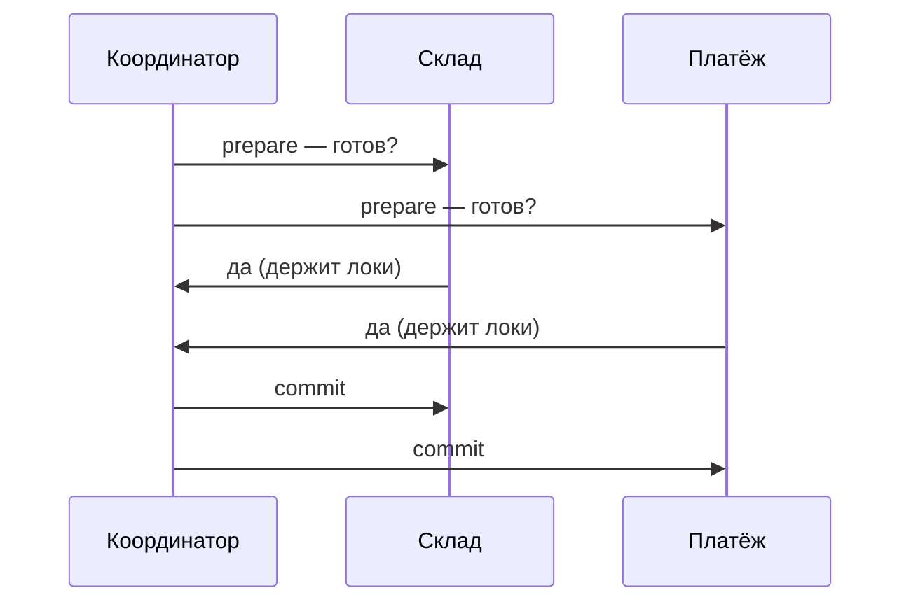

- **Блокирующий** — пока идёт голосование, участники держат локи.
- Плохо масштабируется и снижает availability.

Поэтому в микросервисах 2PC почти не используют — используют [Saga](#saga).

!!! warning "Ловушка: падение координатора между фазами"
    Если координатор умер после prepare, но до commit, участники не знают, коммитить или откатывать. Они держат локи и ждут, пока координатор не вернётся. Один упавший узел блокирует ресурсы во всех сервисах.

??? question "Проверь себя"
    1. Из каких двух фаз состоит 2PC?
    2. Почему 2PC называют блокирующим протоколом?
    3. Что случится, если координатор умрёт между фазами?

### Как работает Saga? { #saga }

**Уровень:** Senior

!!! abstract "Ответ вслух"
    Saga — цепочка локальных транзакций в разных сервисах, у каждой есть компенсирующая транзакция. Если шаг 3 упал, выполняются компенсации шагов 2 и 1: «вернуть товар на склад», «отменить платёж». Координировать сагу можно хореографией через события или оркестрацией через центральный сервис.

Единого `ROLLBACK` по микросервисам нет, поэтому Saga откатывает изменения **компенсирующими транзакциями** — шагами отмены.

**Choreography (хореография)** — центра нет, сервисы общаются событиями. А сохранил данные и кинул событие, Б поймал, обновил и кинул своё. Если В падает, он кидает `FailedEvent`, А и Б ловят его и компенсируют.

- ➕ Слабая связность, нет единой точки отказа.
- ➖ При 4+ сервисах логику почти невозможно отследить.

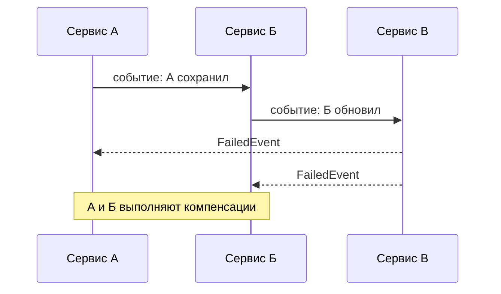

**Orchestration (оркестрация)** — центральный оркестратор (стейт-машина) шлёт команды: «А, сохрани» → ждёт → «Б, обнови» → ждёт. Если В вернул ошибку, оркестратор шлёт А и Б команды отката.

- ➕ Весь флоу в одном месте, легче мониторить.
- ➖ Оркестратор — единая точка отказа и может обрасти сложной логикой.

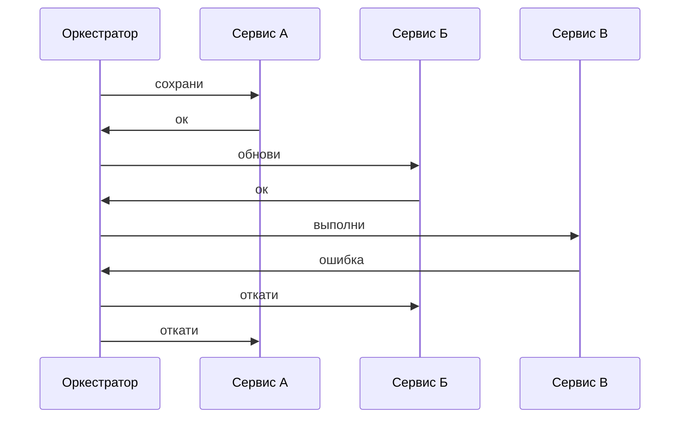

!!! warning "Ловушка: Saga не даёт изоляции"
    В середине саги система в промежуточном состоянии: платёж прошёл, доставки ещё нет. Другие запросы видят это состояние — это eventual consistency, и дизайн должен это учитывать.

??? question "Проверь себя"
    1. Чем компенсирующая транзакция отличается от `ROLLBACK`?
    2. Чем хореография отличается от оркестрации и какие у каждой минусы?
    3. Почему Saga не даёт изоляции?

### Что такое Transactional Outbox? { #outbox }

**Уровень:** Senior

!!! abstract "Ответ вслух"
    Outbox решает проблему dual write — когда нужно атомарно сохранить данные в БД и отправить событие в брокер. В той же транзакции, что и бизнес-данные, событие пишется в таблицу `outbox_events`. Отдельный процесс, часто Debezium по WAL, перекладывает события из outbox в Kafka.

**Проблема dual write.** Редактор публикует новость: нужно 1) сохранить её в PostgreSQL и 2) отправить событие в Kafka. Если сначала БД, а Kafka моргнёт — сервисы не узнают о новости. Если сначала Kafka, а БД упадёт — получится фантомное событие без данных.

**Решение** — в той же транзакции БД писать во вторую таблицу `outbox_events`:

```sql
BEGIN;
INSERT INTO news_metadata (id, title) VALUES (1, 'Новый листинг');
INSERT INTO outbox_events (id, aggregate_type, payload)
    VALUES (100, 'News', '{...json...}');
COMMIT;
-- Транзакция гарантирует: либо всё, либо ничего
```

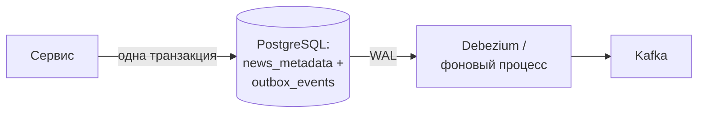

Отдельный фоновый процесс — часто Debezium, читающий WAL-логи БД, — сканирует `outbox_events` и надёжно перекладывает сообщения в Kafka. Отправленное удаляется из outbox.

!!! warning "Ловушка: Outbox даёт at-least-once, а не exactly-once"
    Процесс-перекладчик может отправить событие в Kafka и упасть, не успев удалить его из outbox. После рестарта событие уйдёт повторно. Поэтому консьюмеры за Outbox всё равно должны быть [идемпотентными](#delivery-guarantees).

??? question "Проверь себя"
    1. Что такое dual write и чем он опасен в обоих порядках?
    2. Почему запись в `outbox_events` должна быть в той же транзакции?
    3. Кто и как доставляет события из outbox в Kafka?

## Микросервисы { #microservices }

### Монолит или микросервисы? { #monolith-vs-microservices }

**Уровень:** Middle

!!! abstract "Ответ вслух"
    Монолит проще разрабатывать, деплоить и тестировать на старте, у него одна БД и обычные ACID-транзакции. Микросервисы дают независимый деплой и масштабирование, автономию команд и свободу стека, но приносят сетевую сложность и распределённые транзакции. Начинают с монолита и выделяют сервисы под конкретную причину.

- **Монолит** — одно разворачиваемое приложение. Проще разрабатывать, деплоить и тестировать на старте, единая БД и обычные ACID-транзакции. Минусы приходят с ростом: нельзя масштабировать отдельные части, команды мешают друг другу, стек — один навсегда.
- **Микросервисы** — независимые сервисы: отдельный деплой и масштабирование, автономия команд, свобода стека. Цена — сетевая сложность, [распределённые транзакции](#saga), сложная наблюдаемость, ops-overhead.

Компромисс между мирами — модульный монолит, он разобран в [Архитектура → Модульный монолит](../architecture/architecture.md#modular-monolith). Внутреннее устройство отдельного сервиса — DDD, Hexagonal, CQRS и Event Sourcing — тоже в [Архитектура приложения](../architecture/architecture.md).

!!! warning "Ловушка: distributed monolith"
    Худший исход: систему разбили на сервисы, но они так связаны, что деплоятся только вместе. Это минусы обоих миров сразу. Зрелый ответ на собесе: «начинаем с монолита, выделяем сервисы под конкретную причину — масштаб, автономия команд, — а не рефлекторно».

??? question "Проверь себя"
    1. В чём плюсы монолита на старте проекта?
    2. Чем платят за микросервисы?
    3. Что такое distributed monolith?

### Зачем нужны API Gateway, BFF и Service Discovery? { #api-gateway }

**Уровень:** Middle

!!! abstract "Ответ вслух"
    API Gateway — единая точка входа для клиентов: маршрутизация к сервисам, аутентификация, rate limiting, агрегация ответов. BFF (Backend For Frontend) — отдельный лёгкий бэкенд под конкретного клиента, который собирает данные для экрана одним запросом. Service Discovery — реестр живых инстансов, через который сервисы находят друг друга при автоскейлинге.

- **API Gateway** — клиент общается с gateway, а не с десятком сервисов. Gateway маршрутизирует к нужному микросервису, проверяет JWT-токены, ограничивает частоту запросов (rate limiting, защита от DDoS) и агрегирует ответы. В Java — Spring Cloud Gateway.
- **BFF (Backend For Frontend)** — развитие gateway: отдельный сервис под конкретного клиента, один для веба, другой для мобилки. Вместо 10 запросов с фронта к складу, биллингу и профилю — 1 запрос к BFF, который сам соберёт данные по микросервисам и вернёт готовый JSON под конкретный экран.
- **Service Discovery** — реестр живых инстансов (Eureka, Consul). Нужен, потому что при автоскейлинге инстансы постоянно появляются и исчезают.

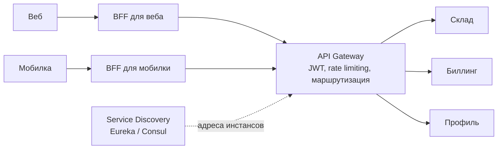

!!! warning "Ловушка: бизнес-логика в gateway"
    Gateway — инфраструктурный слой: маршрутизация, аутентификация, лимиты. Если в него начинают переносить бизнес-правила, он становится узким местом, через которое проходит каждый релиз каждой команды. Сборку данных под конкретный экран выносят в BFF.

??? question "Проверь себя"
    1. Какие задачи решает API Gateway?
    2. Чем BFF отличается от общего gateway?
    3. Зачем нужен Service Discovery при автоскейлинге?

### Как работает rate limiting? { #rate-limiting }

**Уровень:** Middle

!!! abstract "Ответ вслух"
    Rate limiting ограничивает частоту запросов: защищает от абьюза и брутфорса, делит ресурсы честно и контролирует затраты. Основные алгоритмы — fixed window, sliding window, token bucket и leaky bucket. Token bucket разрешает всплески до размера ведра, leaky bucket выравнивает поток.

| Алгоритм | Суть | Особенность |
|---|---|---|
| **Fixed window** | Счётчик на фиксированное окно (100/мин) | Проблема границы: 100 в конце минуты + 100 в начале следующей = 200 за пару секунд |
| **Sliding window log** | Храним timestamp каждого запроса | Точно, но ест память |
| **Sliding window counter** | Взвешенный гибрид текущего и прошлого окна | Хороший баланс точности и памяти для прода |
| **Token bucket** | Токены капают со скоростью R, запрос тратит токен | **Разрешает всплески** до размера ведра |
| **Leaky bucket** | Запросы «вытекают» с постоянной скоростью | **Выравнивает** поток, всплесков не допускает |

Различие, которое спрашивают: token bucket допускает burst — накопил токены, потратил разом, — а leaky bucket выравнивает поток в ровный темп. Реализация на Redis — в [NoSQL](../database/nosql.md).

!!! warning "Ловушка: локальный счётчик на каждом инстансе"
    При многих инстансах за балансировщиком каждый будет считать лимит по-своему, и реальный предел умножится на число инстансов. Счётчик распределённого лимитера должен быть общим — атомарные инкременты в **Redis**.

??? question "Проверь себя"
    1. В чём проблема границы окна у fixed window?
    2. Чем token bucket отличается от leaky bucket?
    3. Где хранить счётчик, если сервис запущен в нескольких инстансах?

## Надёжность и эксплуатация { #reliability }

Аксиома распределённых систем: **всё рано или поздно падает** — сеть моргает, сервисы тормозят, диски умирают. Дизайн отвечает не на вопрос «как избежать сбоев», а «как выжить при них». В Java эти паттерны собраны в **Resilience4j**.

### Зачем нужны timeout и retry с backoff? { #timeout-retry }

**Уровень:** Middle

!!! abstract "Ответ вслух"
    Timeout — никогда не ждать ответа бесконечно: зависшие вызовы копят потоки и соединения, и медленный сосед вешает твой сервис. Retry повторяет запрос при временном сбое, но с экспоненциальной паузой и случайным разбросом (jitter), чтобы не добить лежащий сервис. Ретраить можно только идемпотентные операции.

**Timeout** — базовая и часто забываемая защита. Без него зависшие вызовы копят потоки и соединения.

**Retry + exponential backoff + jitter** — повтор при временном сбое, но с умом:

- Пауза растёт экспоненциально (1 с → 2 с → 4 с) — даём сервису восстановиться.
- **Jitter** — случайная добавка к паузе. Без неё все клиенты ретраят синхронно и добивают лежащий сервис (**retry storm / thundering herd**).
- Ретраить — только **идемпотентные** операции, иначе дважды спишешь деньги.

```java
@Retry(name = "bankApi")
// application.yml:
// resilience4j.retry.bankApi.max-attempts: 4
// resilience4j.retry.bankApi.wait-duration: 1s
// resilience4j.retry.bankApi.exponential-backoff-multiplier: 2
```

!!! warning "Ловушка: ретраи без jitter"
    Если тысяча клиентов получила ошибку в одну секунду и все ретраят ровно через 1, 2, 4 секунды, на сервис приходят синхронные волны нагрузки. Он не успевает подняться между ними. Jitter размазывает повторы во времени.

??? question "Проверь себя"
    1. Почему вызов без timeout опасен для вызывающего сервиса?
    2. Зачем к exponential backoff добавляют jitter?
    3. Какие операции нельзя ретраить?

### Как работает circuit breaker? { #circuit-breaker }

**Уровень:** Middle

!!! abstract "Ответ вслух"
    Circuit breaker (предохранитель) считает ошибки вызовов к зависимости. Когда их доля превышает порог, он размыкается и сразу отклоняет запросы, не дёргая упавший сервис; через паузу пропускает несколько пробных. Так локальный сбой не превращается в каскадный отказ всей системы.

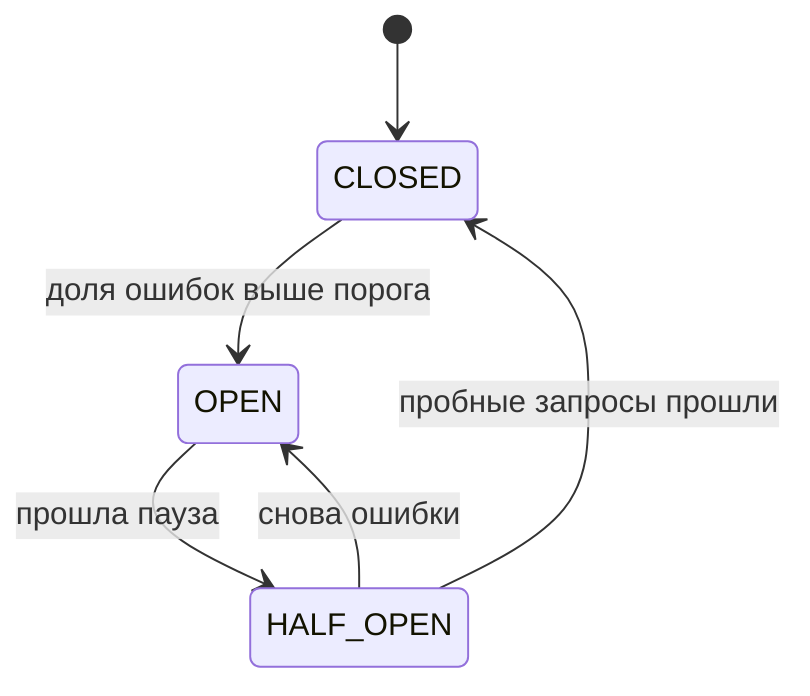

- **Closed** — работаем, считаем ошибки.
- **Open** — мгновенно отклоняем запросы, не дёргая мёртвый сервис: fail fast, не тратим ресурсы, даём упавшему передышку.
- **Half-open** — пропускаем несколько пробных запросов.

```java
// Resilience4j — стандарт де-факто в Java
@CircuitBreaker(name = "bankApi", fallbackMethod = "fallbackBonus")
public BonusResult calculateBonus(Long userId) {
    return bankApiClient.getBonus(userId); // может зависнуть
}

// Fallback — когда предохранитель открыт
public BonusResult fallbackBonus(Long userId, Throwable t) {
    log.warn("Банк недоступен, возвращаем дефолт", t);
    return BonusResult.empty();
}
```

`@CircuitBreaker` работает через прокси, поэтому на самовызов внутри класса не срабатывает — механика разобрана в [Spring Core](../spring/spring-core.md).

!!! warning "Ловушка: circuit breaker без fallback"
    В состоянии Open запросы отклоняются сразу, и без fallback пользователь получит ошибку вместо ответа. Fallback возвращает дефолт или кэш — это и есть [graceful degradation](#bulkhead).

??? question "Проверь себя"
    1. Опиши три состояния circuit breaker и переходы между ними.
    2. Зачем нужно состояние Half-open?
    3. Что делает fallback-метод?

### Что такое bulkhead и graceful degradation? { #bulkhead }

**Уровень:** Middle

!!! abstract "Ответ вслух"
    Bulkhead (переборка) — отдельные пулы потоков и соединений на каждую зависимость, как отсеки корабля. Зависли вызовы к сервису А и выели свой пул — вызовы к Б живут на своём. Graceful degradation — отдать урезанный, но рабочий ответ вместо 500: страница товара без блока «похожие», если упал сервис рекомендаций.

- **Bulkhead** — без переборок один медленный dependency вешает всё приложение, потому что занимает общий пул.
- **Graceful degradation / fallback** — часто реализуется как fallback у circuit breaker: в Open отдаём кэш или дефолт. Это разница между «сайт лагает» и «сайт лежит».

!!! warning "Ловушка: один общий пул на все вызовы"
    Если все внешние вызовы делятся одним пулом потоков, медленный платёжный шлюз займёт его целиком. Тогда перестанут работать и запросы, которым платёжный шлюз вообще не нужен. Переборка ограничивает ущерб одной зависимостью.

??? question "Проверь себя"
    1. Как bulkhead защищает приложение от медленной зависимости?
    2. Что такое graceful degradation? Приведи пример.
    3. Как связаны fallback и circuit breaker?

### Что такое observability? { #observability }

**Уровень:** Middle

!!! abstract "Ответ вслух"
    Observability (наблюдаемость) — способность понять, что происходит в проде, не заходя на серверы. Три столпа: метрики — сколько и как часто, логи — что произошло, трейсы — где именно затык на пути запроса через сервисы. Алерты строят по симптомам для пользователя — четырём золотым сигналам: latency, traffic, errors, saturation.

Когда прод падает, нельзя зайти по SSH на каждый сервер и читать логи глазами. Нужны инструменты расследования:

- **Metrics** — числовые агрегаты во времени: QPS, latency (**p50/p95/p99**, не среднее), error rate, CPU и память, глубина очередей. Например: сколько памяти занято в Heap, сколько активных соединений в HikariCP, какой процент ответов API — 500. Стек — Prometheus + Grafana.
- **Logs** — что произошло, текстовые записи событий. В распределённой системе логи **структурированные** (JSON) и централизованные: ELK/EFK (Elasticsearch + Logstash или Fluentd + Kibana) или Loki. Иначе логи 30 сервисов бесполезны.
- **Traces** — где именно: путь запроса через сервисы. **Trace id** протаскивается через все вызовы, а каждый участок — span с таймингом; OpenTelemetry, Jaeger, Zipkin. Отвечает на вопрос «запрос прошёл 8 сервисов — где затык?».

Чтобы найти все логи одного запроса через 5 микросервисов, `traceId` кладут в MDC логгера — он попадает в каждую строку лога. Метрики в Spring Boot собирает Micrometer через Actuator — это разобрано в [Spring: Инструменты](../spring/spring-tools.md).

!!! warning "Ловушка: алерт на каждую мелочь"
    Если алертить по каждому всплеску CPU, дежурные привыкают игнорировать уведомления (alert fatigue) и пропускают настоящий сбой. Алерты строят по симптомам для пользователя — **четырём золотым сигналам Google SRE**: latency, traffic, errors, saturation. Мониторинг этих четырёх покрывает большинство проблем.

??? question "Проверь себя"
    1. Назови три столпа observability и на какой вопрос отвечает каждый.
    2. Как найти все логи одного запроса, прошедшего через несколько сервисов?
    3. Что такое четыре золотых сигнала?

### Чем liveness отличается от readiness? { #health-checks }

**Уровень:** Junior

!!! abstract "Ответ вслух"
    Liveness проверяет, жив ли процесс: если нет, оркестратор его перезапускает. Readiness проверяет, готов ли инстанс принимать трафик: прогрет ли кэш, есть ли соединение с БД. Пока readiness не пройден, балансировщик не шлёт на инстанс запросы, но и не убивает его.

В Spring Boot обе проверки отдаёт Actuator `/health` — подробно в [Spring Boot → Actuator](../spring/spring-boot.md).

!!! warning "Ловушка: проверять БД в liveness"
    Если liveness падает при недоступной БД, то при сбое базы оркестратор начнёт перезапускать все инстансы приложения — хотя они живы и просто ждут. Зависимости проверяют в readiness, а liveness отвечает только за сам процесс.

??? question "Проверь себя"
    1. Что делает оркестратор, если не прошёл liveness, а что — если readiness?
    2. Почему проверку соединения с БД кладут в readiness?
    3. Какой эндпоинт Spring Boot отдаёт состояние здоровья?

### Что такое sidecar? { #sidecar }

**Уровень:** Middle

!!! abstract "Ответ вслух"
    Sidecar — паттерн деплоя в Kubernetes: рядом с приложением в том же поде запускается отдельный контейнер для логов, метрик или проксирования. Контейнеры делят сеть и диск, но изолированы по процессам. Приложение просто пишет в stdout, а sidecar собирает логи и отправляет дальше.

Аналогия — мотоцикл с коляской: бизнес-логика — «мотоцикл», логирование, метрики и проксирование — «коляска». Тяжёлая инфраструктура логирования не тащится в код приложения.

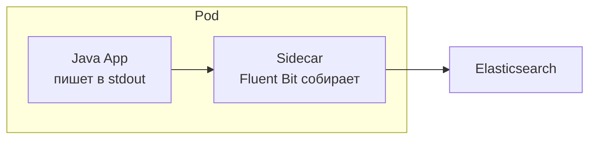

!!! warning "Ловушка: sidecar бесплатен"
    Sidecar — это ещё один контейнер в каждом поде со своими CPU и памятью. При сотнях подов накладные расходы заметны, и лимиты ресурсов нужно задавать и для него.

??? question "Проверь себя"
    1. Что общего у приложения и sidecar в одном поде, а что раздельно?
    2. Как приложение передаёт логи sidecar?
    3. Зачем выносить сбор логов в sidecar, а не в код?

### Как масштабировать сервис? { #scaling }

**Уровень:** Junior

!!! abstract "Ответ вслух"
    Вертикально — мощнее сервер: просто, но есть потолок железа и единая точка отказа. Горизонтально — больше серверов за балансировщиком; это путь по умолчанию, и он требует stateless-серверов. Когда сессии лежат в Redis или в JWT, любой инстанс обслужит любого пользователя, и работает автоскейлинг.

- **Вертикальное (scale up)** — мощнее сервер (CPU, RAM). Просто, но есть потолок железа, наверху дорого, единая точка отказа.
- **Горизонтальное (scale out)** — больше серверов за балансировщиком. Дефолтный путь. Требование — stateless.

**Stateless** — сервер не хранит состояние клиента в своей памяти: сессии — в Redis или БД либо в JWT у клиента. Тогда инстансы взаимозаменяемы, и становится возможен **autoscaling** — добавлять и убивать инстансы по CPU или QPS. Фраза для собеса: «делаем серверы stateless, состояние в Redis — и горизонтальное масштабирование становится тривиальным».

**Load shedding** — при перегрузке осознанно отбросить часть запросов, например низкоприоритетные, чтобы корректно обслужить остальные. Лучше отказать 5%, чем деградировать на 100%.

!!! warning "Ловушка: состояние в памяти инстанса"
    Локальный кэш сессий, загруженные файлы на диске контейнера, счётчики в памяти — всё это делает инстансы невзаимозаменяемыми. Автоскейлер убьёт инстанс — и пользователи потеряют данные. Состояние выносят в общие хранилища.

??? question "Проверь себя"
    1. Чем вертикальное масштабирование отличается от горизонтального?
    2. Что значит stateless и почему это условие горизонтального масштабирования?
    3. Что такое load shedding?

### Какие хранилища нужны, кроме основной БД? { #polyglot-persistence }

**Уровень:** Middle

!!! abstract "Ответ вслух"
    Под разные задачи — разные хранилища (polyglot persistence). Большие файлы — в object storage вроде S3, а в базе только ключ. Метрики — в time-series базу, полнотекстовый поиск — в Elasticsearch, «найди ближайшее» — в geo-индекс.

- **Object storage** (S3, GCS) — картинки, видео, бэкапы. Паттерн: **файлы не в БД** — в базе только ключ или URL, сам файл в S3, раздача через CDN. **Presigned URL** — клиент грузит файл напрямую в S3 по временной подписанной ссылке, минуя твой бэкенд.
- **Time-series** (Prometheus, InfluxDB, TimescaleDB) — метрики, IoT, котировки: поток записи и агрегаты по временным диапазонам.
- **Search** (Elasticsearch, OpenSearch) — полнотекстовый поиск, который SQL делает плохо: `LIKE '%слово%'` не масштабируется, нет релевантности и исправления опечаток. Внутри — **инвертированный индекс** (слово → документы). Паттерн: истина в SQL, копия для поиска в ES, синхронизация через события.
- **Geo** — «найди ближайшее» (такси, доставка): **geohash** (близкие точки → общий префикс строки) или quadtree, R-tree. Из коробки: Redis GEO, PostGIS.

Примеры polyglot persistence в Spring Boot — в [NoSQL](../database/nosql.md).

!!! warning "Ловушка: Elasticsearch как источник истины"
    Поисковый индекс — копия данных, синхронизируемая событиями, и он может отставать или потерять часть обновлений. Источником истины остаётся SQL-база, а индекс при необходимости переиндексируют из неё.

??? question "Проверь себя"
    1. Почему файлы не хранят в реляционной БД и что такое presigned URL?
    2. Почему `LIKE '%слово%'` не заменяет поисковый движок?
    3. Как geohash помогает искать ближайшие точки?

### Как учитывать безопасность в дизайне? { #security }

**Уровень:** Middle

!!! abstract "Ответ вслух"
    Аутентификация (AuthN) отвечает на вопрос «кто ты», авторизация (AuthZ) — «что тебе можно», и первое идёт до второго. Сессии в Redis легко отозвать, но нужен общий стор; JWT не требует стора, но его трудно отозвать до истечения. Трафик шифруют TLS, данные на дисках — at rest, пароли хранят только как хэш с солью.

- **AuthN vs AuthZ** — аутентификация: логин и пароль, токен; авторизация: права. Сначала первое, потом второе.
- **Sessions vs JWT:**

| | **Сессии (в Redis)** | **JWT** |
|---|---|---|
| **Состояние** | На сервере (session id в куке) | В самом токене (stateless) |
| **Отзыв** | Мгновенный — удалил из стора | Трудный до истечения → короткий TTL access + refresh token |
| **Масштабирование** | Нужен общий стор | Идеально для scale out — сервер проверяет только подпись |

- **OAuth 2.0 / OpenID Connect** — делегированный доступ («Войти через Google»): приложение получает токен, не видя пароль. OAuth 2.0 — авторизация (доступ к ресурсам), OIDC — аутентификация поверх него (кто пользователь). В Java — Spring Security OAuth2, разобран в [Spring: Экосистема](../spring/spring-security.md).
- **Шифрование** — in transit (TLS — обязательно) и at rest (диски БД, бэкапы). Пароли — только хэш с солью (bcrypt, argon2). Секреты и ключи — в Vault или Secrets Manager, не в коде.

!!! warning "Ловушка: JWT подписан, но не зашифрован"
    Содержимое JWT читается любым, у кого есть токен: payload — это Base64, а не шифр. Подпись защищает только от подделки. Секреты внутри токена не хранят.

??? question "Проверь себя"
    1. Чем аутентификация отличается от авторизации?
    2. Почему JWT трудно отозвать и как с этим живут?
    3. Чем OAuth 2.0 отличается от OpenID Connect?

## Собеседование { #interview }

### Как проходить интервью по system design? { #methodology }

**Уровень:** Middle

=== "Коротко"

    !!! abstract "Ответ вслух"
        За ~40 минут пройди шесть шагов по порядку: требования, оценка масштаба, API, модель данных и high-level дизайн, deep dive, узкие места и trade-off'ы. Чаще валятся не на знаниях, а на структуре — прыгают в детали БД, не выяснив, что строят. Думай вслух и озвучивай цену каждого решения.

=== "Подробно"

    ```mermaid
    flowchart LR
        R["1. Требования<br/>~5 мин"] --> E["2. Масштаб<br/>~5 мин"]
        E --> A["3. API<br/>~5 мин"]
        A --> H["4. Данные + HLD<br/>~10 мин"]
        H --> D["5. Deep dive<br/>~10 мин"]
        D --> B["6. Bottlenecks<br/>~5 мин"]
    ```

    **1. Требования (~5 мин).** Никакого кода и квадратиков.

    - **Функциональные** — что система делает: только списываем и начисляем? Нужна история? Бронирование?
    - **Нефункциональные** — в каких условиях: какой RPS? Критична ли latency? Что важнее — availability или consistency?
    - Явно **сузь скоуп**: «фокусируюсь на X и Y, Z отмечу как расширение» — так показывают зрелость.

    Для ERP и финансов ответ про приоритет почти всегда — consistency: лучше система выдаст ошибку, чем продаст один товар двум людям.

    **2. Оценка масштаба (~5 мин).** [Back-of-the-envelope](#estimation): QPS средний и пиковый, read:write, объём на годы. Из чисел — архитектурные выводы: «100:1 → кэш», «терабайты → шардинг». Не пропускай: этот шаг обосновывает всё дальнейшее.

    **3. API (~5 мин).** Пара ключевых эндпоинтов — контракт системы:

    ```text
    POST /api/v1/inventory/reserve     — забронировать товар
    GET  /api/v1/inventory/{item_id}   — получить остатки
    ```

    Покажи понимание версионирования, идемпотентности (что будет, если клиент дважды вызовет POST из-за лага?) и правильных HTTP-статусов.

    **4. Модель данных + High-Level Design (~10 мин).** Рассуждай вслух: «Выбираю реляционную БД, потому что нужны строгие гарантии целостности и джоины для отчётов». Обсуди индексы, для критичных данных — append-only историю или Event Sourcing для аудита. Затем крупные блоки и поток данных:

    ```mermaid
    flowchart LR
        C["Клиент"] --> G["API Gateway"]
        G --> W["Warehouse Service"]
        W --> P[("PostgreSQL<br/>транзакция")]
        W --> K["Event Bus (Kafka)"]
        K --> B["Billing Service"]
        K --> A["Analytics"]
        K --> N["Notification"]
    ```

    **5. Deep dive (~10 мин).** Интервьюер начнёт ломать систему: _«А что если сервер упадёт после записи в БД, но до отправки в Kafka?»_ Здесь пригодятся [Transactional Outbox](#outbox), [идемпотентность консьюмеров](#delivery-guarantees), выбор shard key и стратегия кэша.

    **6. Bottlenecks и trade-off'ы (~5 мин).** Сам подними слабые места: единые точки отказа, hotspot'ы, поведение на пике. На этом шаге проверяют главное — видишь ли ты цену каждого выбора.

    Три правила:

    1. **Думай вслух.** Молчать 5 минут и выдать идеал хуже, чем 5 минут рассуждать о компромиссах и выдать решение с небольшим изъяном.
    2. **Нет серебряной пули.** У каждого решения есть плюсы и минусы — озвучивай их.
    3. **Озвучивай компромиссы:** «Redis для остатков даст скорость, но риск stale data — поэтому для чекаута идём в master-базу».

!!! warning "Ловушка: начать с базы данных"
    Самая частая ошибка — сразу рисовать таблицы и выбирать БД, не выяснив требования и масштаб. Тогда любое решение выглядит необоснованным, а интервьюер может сменить условия, и дизайн рассыпается. Требования и числа — всегда первые 10 минут.

??? question "Проверь себя"
    1. Назови шесть шагов интервью по system design по порядку.
    2. Зачем явно сужать скоуп на первом шаге?
    3. Что обсуждают на шаге bottlenecks?

### Как спроектировать URL shortener? { #url-shortener }

**Уровень:** Senior

!!! abstract "Ответ вслух"
    Система крайне read-heavy: ~40 QPS записи против ~4000 чтения, поэтому редирект обслуживается из кэша. Короткий код — 7 символов base62, а генерирует их Key Generation Service, раздающий серверам диапазоны id. Хранилище — key-value с шардированием по хэшу кода, аналитика кликов — асинхронно через Kafka.

Эталонный проход по [методологии](#methodology).

**1. Требования.** Функциональные: укоротить URL; редиректить по короткому. Расширения — проговорить и отложить: кастомные алиасы, TTL ссылки, аналитика кликов. Нефункциональные: крайне **read-heavy**, редирект — **очень быстрый**, высокая **availability** (редиректы лежат — все ссылки мертвы), коды уникальны.

**2. Масштаб.** 100M новых ссылок в месяц → запись ≈ **40 QPS**. Read:write 100:1 → чтение ≈ **4000 QPS** (пик ~10 000) → **агрессивный кэш**. Хранилище: запись ~500 байт × 6 млрд за 5 лет ≈ **~3 ТБ** → закладываем **шардирование**; длина кода: base62 (a–z, A–Z, 0–9), 62⁷ ≈ 3.5 трлн → **7 символов** хватит с запасом.

**3. API.**

```text
POST /shorten          body: { longUrl } → { shortUrl }
GET  /{shortCode}      → 301/302 redirect на longUrl
```

**4. High-level.** Клиент → LB → stateless-сервис → Redis (cache-aside) → БД. Запись: сгенерировать код, сохранить пару. Чтение: кэш → miss → БД → положить в кэш → редирект.

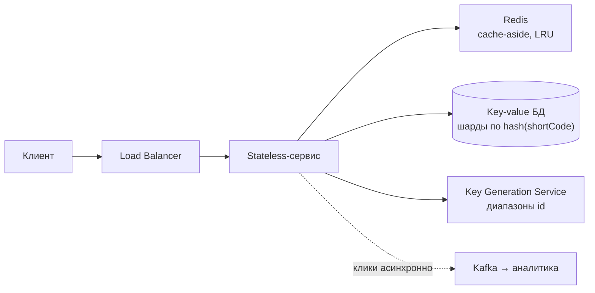

**5. Deep dive — генерация кода.** Сюда копают в первую очередь:

- **А: хэш URL (MD5) + 7 символов.** Просто, но **коллизии** — проверка в БД и перегенерация, лишние чтения при записи.
- **Б: глобальный счётчик + base62.** Уникально без коллизий, но общий счётчик — узкое место и точка отказа при многих серверах.
- **В (лучший): Key Generation Service с диапазонами.** Отдельный сервис (или Redis, ZooKeeper) выдаёт серверам **диапазоны** id пачками: A — 1–1000, B — 1001–2000. Сервер раздаёт коды локально из своего диапазона: нет общего счётчика на каждый запрос, коллизии невозможны в принципе.

**5б. Deep dive — хранилище и кэш.** Паттерн доступа — точечный lookup `shortCode → longUrl` без связей и транзакций, это **кейс для key-value NoSQL** (DynamoDB, Cassandra), который тривиально шардится. Шардирование — hash по `shortCode`: диапазонные запросы не нужны, поэтому минус hash-шардинга не мешает. Кэш — Redis с LRU: популярные ссылки живут в кэше, hit rate высокий.

**6. Bottlenecks.**

- Редирект — критический путь: кэш обязателен, очень популярные ссылки — на CDN или edge.
- KGS — точка отказа: реплицируем, а серверы держат запас предвыданного диапазона.
- Hotspot (вирусная ссылка) сглаживают кэш и CDN.
- Аналитика кликов — **не синхронно** в пути редиректа: событие в Kafka, обработка асинхронно.

!!! warning "Ловушка: 301 или 302"
    **301 (permanent)** кэшируется браузером: повторные переходы быстрее, но клики идут мимо тебя, и аналитики нет. **302 (temporary)** — каждый клик идёт к тебе: есть аналитика, но чуть медленнее. Нужна аналитика — бери 302.

??? question "Проверь себя"
    1. Почему 7 символов base62 достаточно?
    2. Чем Key Generation Service с диапазонами лучше хэша URL и глобального счётчика?
    3. Почему аналитику кликов не пишут синхронно в пути редиректа?

### Ради чего спрашивают классические задачи? { #classic-tasks }

**Уровень:** Middle

!!! abstract "Ответ вслух"
    Каждую классическую задачу спрашивают ради конкретного приёма: URL shortener — ради генерации ключей, news feed — ради fan-out, чат — ради WebSocket и порядка сообщений, такси — ради геоиндексов. Готовя задачу, отрабатывай именно её приём. Для ленты стандартный ответ — гибрид push для обычных пользователей и pull для звёзд.

| Задача | Ради чего спрашивают |
|---|---|
| **URL shortener** | Генерация уникальных ключей (KGS + диапазоны), кэш, 301 vs 302 |
| **Pastebin** | То же + object storage (S3) для больших текстов, TTL, приватность |
| **Rate limiter** | Алгоритмы (token bucket и др.), распределённый счётчик в Redis |
| **News feed / Twitter** | **Fan-out on write vs on read**, гибрид для «звёзд», eventual consistency |
| **Чат / мессенджер** | WebSocket (persistent connections), доставка и порядок сообщений, presence |
| **Uber / такси** | Геоиндексы (geohash/quadtree), real-time обновления локаций, матчинг |
| **YouTube / Netflix** | Загрузка → транскодинг через очередь → CDN, адаптивный стриминг (HLS/DASH) |
| **Google Drive / Dropbox** | Чанкинг файлов, дедупликация, синхронизация, разрешение конфликтов |
| **Автокомплит** | Префиксное дерево (trie) + топ-K, прекомпьют популярных подсказок |
| **Нотификации** | Очереди с приоритетами, идемпотентность, ретраи, DLQ |
| **Distributed cache** | Consistent hashing, репликация, LRU |

**Fan-out:**

- **On write (push)** — при публикации поста раскладываем его в ленты всех подписчиков. Чтение мгновенное, но пост звезды с 50M фолловеров — это 50M записей.
- **On read (pull)** — собираем ленту в момент запроса. Запись дешёвая, чтение дорогое.
- **Гибрид** — стандартный ответ: push для обычных пользователей, pull для звёзд.

!!! warning "Ловушка: чистый fan-out on write"
    Push-модель хороша, пока у автора сотни подписчиков. Один пост звезды с 50M фолловеров порождает 50M записей и забивает систему на минуты. Поэтому звёзд обрабатывают через pull и подмешивают их посты при чтении.

??? question "Проверь себя"
    1. Ради какого приёма спрашивают news feed?
    2. Чем fan-out on write отличается от fan-out on read?
    3. Какие приёмы ждут в задаче про такси?

## Разбор кейсов { #cases }

### Почему Round Robin убивает один сервер? { #case-round-robin }

**Уровень:** Middle

!!! abstract "Ответ вслух"
    Round Robin раздаёт запросы вслепую, не зная их веса. Если на один сервер подряд попали несколько тяжёлых PDF-запросов, они копятся, а новые продолжают приходить. Лечится Least Connections или L7-роутингом по типу запроса, а тяжёлые отчёты лучше вынести в асинхронную очередь.

**Проблема:** 3 сервера генерируют PDF-отчёты, L4 + Round Robin, трафик равномерный. Но один сервер регулярно падает от OOM, а два других загружены на 20%.

**Решение:** генерация PDF — тяжёлая долгая операция. Если на один сервер случайно попало несколько тяжёлых запросов подряд, они копятся, а Round Robin продолжает слать новые. Варианты:

1. **Least Connections** — увидит, что сервер занят.
2. **L7** — роутинг по типу запроса.
3. **Асинхронная очередь** для тяжёлых PDF — лучший вариант.

!!! warning "Ловушка: «трафик равномерный — значит, балансировка ни при чём»"
    Равномерным может быть число запросов, но не их стоимость. Round Robin выравнивает количество, а не нагрузку. Поэтому смотреть надо на распределение тяжёлых запросов, а не на QPS.

??? question "Проверь себя"
    1. Почему один сервер падает при равномерном трафике?
    2. Какие три решения подходят в этом кейсе?
    3. Почему асинхронная очередь — лучший вариант для PDF?

### Что убило базу в 10:10, если Redis-узел сгорел в 10:05? { #case-stampede }

**Уровень:** Senior

!!! abstract "Ответ вслух"
    Базу убил cache stampede: кэш создан в 10:00 с TTL 10 минут и истёк в 10:10, тысячи клиентов одновременно получили miss и ударили в PostgreSQL. Смерть Redis-узла в 10:05 кэш не положила: кластер по Gossip заметил падение и повысил реплику до Master. Но репликация асинхронная, поэтому последние записи могли потеряться.

**Проблема 1 — что убило базу в 10:10.** [Cache stampede (thundering herd)](#cache-stampede): TTL = 10 минут, кэш создан в 10:00, истёк в 10:10. Тысячи брокеров одновременно получили cache miss и одновременно ударили в PostgreSQL. Лечить — мьютексом (кэш обновляет один поток) или вероятностным ранним обновлением (probabilistic early expiration).

**Проблема 2 — почему смерть Redis в 10:05 не положила кэш.** В Redis Cluster у Master есть Replica. Узлы заметили падение по Gossip, проголосовали и повысили реплику до Master. Но репликация **асинхронная**: если Master принял запись и сгорел до репликации, эти данные потеряны — для кэша это не критично, он пересоберётся из БД.

!!! warning "Ловушка: искать причину в последнем инциденте"
    Падение Redis в 10:05 выглядит очевидной причиной, но кластер его пережил. Настоящая причина — момент истечения TTL. Сопоставляй время сбоя с TTL и расписаниями, а не только с соседними событиями.

??? question "Проверь себя"
    1. Почему база упала именно в 10:10?
    2. Как Redis Cluster пережил потерю узла?
    3. Какие данные могли потеряться при failover и почему это не страшно для кэша?

### Нужно ли шардировать таблицу на 100M строк? { #case-sharding }

**Уровень:** Middle

!!! abstract "Ответ вслух"
    Нет: шардирование здесь — пушка по воробьям, оно принесёт распределённые джоины и ребалансировку ради задачи одного сервера. Бизнесу нужны быстрые свежие новости, а архивы не важны. Горизонтальное партиционирование по году и вертикальное — вынос тяжёлого тела статьи — решают задачу на одной базе.

**Проблема:** таблица `kase_news` — 100M строк за 15 лет. Бизнес: «новости 2026 — мгновенно, на архивы всё равно». DevOps: «шардируем по `year`, 15 серверов».

**Решение:**

1. **Горизонтальное партиционирование** по `year` — БД физически разделит данные, и запрос за 2026 не тронет архивы. Свежие данные — маленькая горячая партиция в RAM.
2. **Вертикальное партиционирование** — вынести тяжёлое тело статьи в отдельную таблицу, оставив в основной `id`, `title`, `date` для быстрых списков.

!!! warning "Ловушка: шардировать по дате"
    Даже если бы шардирование было нужно, `year` — плохой shard key: весь свежий трафик пришёл бы на один шард 2026 года, а 14 остальных простаивали бы. Это классический hotspot range-based ключа.

??? question "Проверь себя"
    1. Почему шардирование здесь избыточно?
    2. Как партиционирование по году ускоряет запросы к свежим новостям?
    3. Чем плох `year` в роли shard key?

### Что делать сервису «Избранное», когда перерубили кабель между ДЦ? { #case-partition }

**Уровень:** Senior

!!! abstract "Ответ вслух"
    Для закладок выбираем AP: цена ошибки низкая, пользователь максимум секунду увидит неактуальный список. Оба дата-центра продолжают принимать запросы, а после починки сети узлы синхронизируются, конфликты решаются, например, по timestamp. При рабочей сети по PACELC тоже выбираем latency.

**Проблема:** экскаватор перерубил кабель Алматы–Астана. Сервис «Избранное», БД в двух дата-центрах, network partition.

**Решение:** выбираем **AP (Availability)**. В момент аварии оба дата-центра продолжают принимать запросы, пользователь добавляет закладки, и они сохраняются локально. После починки сети — eventual consistency: узлы синхронизируются, конфликты решаются, например, по timestamp.

По [PACELC](#pacelc) при рабочей сети тоже выбираем **L (Latency)**: мгновенный отклик важнее идеальной согласованности для такой некритичной фичи.

!!! warning "Ловушка: один ответ для всех сервисов"
    AP правильно для закладок, но неправильно для платежей или остатков на складе — там при разделении лучше отказать. Выбор между C и A делают для каждой фичи отдельно, исходя из цены ошибки.

??? question "Проверь себя"
    1. Почему для закладок выбирают AP?
    2. Как разрешают конфликты после восстановления сети?
    3. Что выбирает этот сервис по PACELC, когда сеть работает?

### Почему письма теряются, дублируются и блокируют очередь? { #case-emails }

**Уровень:** Senior

!!! abstract "Ответ вслух"
    Три бага — три паттерна. Потеря событий — dual write, лечится Transactional Outbox. Дубли писем — at-least-once доставка без идемпотентности, лечится idempotent consumer; блокировка очереди битым JSON — poison pill, лечится Dead Letter Queue.

**Проблема:** сервис News сохраняет новость в БД и шлёт `NewsPublished` в Kafka, EmailSender рассылает письма. Баги: 1) события теряются, 2) приходит по 3 письма, 3) сломанный JSON блокирует очередь.

**Решение — три паттерна:**

1. **[Transactional Outbox](#outbox)** (потеря событий) — сохранять новость и событие в одной транзакции БД, воркер надёжно перекладывает их в Kafka.
2. **[Idempotent consumer](#delivery-guarantees)** (дубли писем) — проверять `event_id` перед отправкой, UNIQUE constraint в БД.
3. **Dead Letter Queue** (poison pill) — после 3 ретраев перекидывать битое сообщение в DLQ, очередь работает дальше. Настройка — в [Kafka: Гарантии доставки](../kafka/kafka-reliability.md).

!!! warning "Ловушка: лечить дубли отказом от ретраев"
    Если убрать ретраи, чтобы не было дублей, получится at-most-once — и письма начнут теряться. Правильный путь — оставить at-least-once и сделать обработку идемпотентной.

??? question "Проверь себя"
    1. Какой паттерн лечит потерю событий при сохранении в БД и отправке в Kafka?
    2. Почему письма приходят по нескольку раз?
    3. Что такое poison pill и как DLQ спасает очередь?

## Шпаргалка { #cheatsheet }

<!-- --8<-- [start:cheatsheet] -->
| Тема | Запомнить |
|---|---|
| **Сеть** | TCP/UDP, HTTP/1–3, DNS, REST vs gRPC — в [Сети и протоколы](../networks/networks.md) |
| **Sync vs async** | Sync — просто, но связность. Async — развязка и буфер, цена — eventual consistency |
| **Latency** | Смотри p99, не среднее — хвост портит UX |
| **Availability** | 99.9% ≈ 8.8 ч/год; 99.99% ≈ 52 мин/год. Каждая девятка — на порядок дороже |
| **Estimation** | Сутки ~10⁵ с, год ~3×10⁷ с; пик = ×2–3; из чисел — архитектурные выводы |
| **L4 vs L7** | L4 — IP/порт, быстро. L7 — URL/заголовки, умный роутинг + SSL termination |
| **RR vs Least Connections** | RR — равные запросы. LC — тяжёлые долгие запросы |
| **Sticky sessions** | Антипаттерн. Лучше — сессии в Redis |
| **Cache-Aside** | Читай кэш → miss → БД → положи в кэш. В Spring — `@Cacheable` |
| **Write-Through vs Write-Behind** | Through — синхронно, свежо. Behind — async, быстро, риск потери |
| **LRU vs LFU** | LRU — давно не трогали. LFU — мало раз трогали |
| **Cache stampede** | Толпа на истёкший TTL. Лечить mutex-локом или ранним обновлением |
| **Redis vs Hazelcast** | Redis — 16 384 слота, smart clients. Hazelcast — 271 партиция, data locality |
| **SQL vs NoSQL** | SQL — связи, ACID, дефолт. NoSQL — масштаб + известный паттерн доступа |
| **Replication** | Master пишет, реплики читают. Replication lag → read-your-writes с master |
| **Partitioning** | Один сервер. Горизонтальное (строки) / вертикальное (столбцы) |
| **Sharding** | Много серверов. Боль: джоины, распределённые транзакции, ребаланс. Hotspot от «звёзд» |
| **Consistent hashing** | Кольцо: новый узел двигает только соседний участок. Виртуальные узлы для равномерности |
| **Очереди** | Point-to-point — один consumer, pub/sub — все. Битые сообщения — в DLQ |
| **CDN** | Edge рядом с пользователем: единицы мс вместо ~150 мс. Pull — дефолт |
| **CAP** | Сеть рвётся всегда → выбор C vs A в аварию. CP — деньги, AP — корзина и закладки |
| **PACELC** | Без аварии — выбор между latency и consistency |
| **Модели согласованности** | Strong → causal → read-your-writes → monotonic → eventual. Бери минимально достаточную |
| **Консенсус** | Кворум N/2+1, кластеры нечётные (3/5); Raft — etcd/Consul/KRaft, ZAB — ZooKeeper |
| **Доставка** | Брокеры = at-least-once → дубли. Exactly-once = at-least-once + идемпотентность |
| **2PC** | Атомарно, но блокирующий и хрупкий — в микросервисах избегают |
| **Saga** | Компенсации вместо rollback. Choreography vs orchestration. Изоляции нет |
| **Transactional Outbox** | Бизнес-данные + событие в одной транзакции. Решает dual write |
| **Монолит vs микросервисы** | Начинай с монолита; distributed monolith — худший исход |
| **API Gateway / BFF** | Gateway — единая точка входа. BFF — 1 запрос → готовый JSON для экрана |
| **Rate limiting** | Token bucket — всплески ок. Leaky — ровный поток. Счётчик — в Redis |
| **Retry** | Только идемпотентные + exponential backoff + jitter (иначе retry storm) |
| **Circuit breaker** | Closed → Open → Half-Open. Fail fast против каскадного отказа |
| **Bulkhead** | Изолируй пулы потоков по зависимостям; fallback — урезанный ответ вместо 500 |
| **Observability** | Metrics (сколько) + logs (что) + traces (где, trace id); золотые сигналы SRE |
| **Liveness vs readiness** | Liveness — жив ли процесс (рестарт). Readiness — готов ли к трафику |
| **Sidecar** | Логи, метрики, прокси — в соседнем контейнере пода, не в коде приложения |
| **Stateless** | Сессии в Redis/JWT → любой сервер обслужит любого → свободный scale out |
| **Object storage** | Файлы в S3 (+ presigned URL для прямой загрузки), в БД только ключ, раздача через CDN |
| **JWT vs sessions** | JWT — stateless, но трудно отозвать (короткий TTL + refresh). Подписан ≠ зашифрован |
| **Методология** | Требования → числа → API → high-level → deep dive → bottlenecks. Думай вслух |
| **URL shortener** | 7 символов base62, KGS с диапазонами, key-value + кэш, 302 ради аналитики |
| **Fan-out** | On write — быстрое чтение, дорого для звёзд → гибрид push + pull |

<!-- --8<-- [end:cheatsheet] -->
